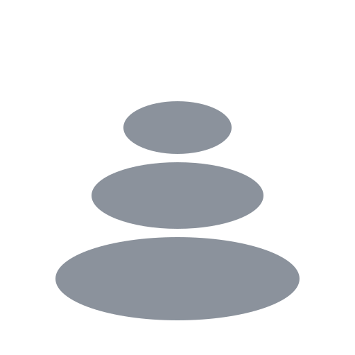

# Cairn

A cairn is a stack of stones that marks the trail for whoever comes next.

Cairn is a context nexus for your work. It gathers what's happening across the tools you already use, such as your tracker, chat, email, code host, meetings and coding-agent sessions, and keeps it as short, dated facts with links to their sources. The agents you work with ask Cairn what's going on, so they start every task already knowing what was decided, who owns what and what changed. A few productivity tools sit on the same context and adapt to whatever you connect: your tasks for the day, a briefing, meeting notes, and dashboards you build yourself.

Cairn is free and open source, and runs on your own computer. It has no server and sends no telemetry.

## Status

Cairn is in design. It succeeds [Pulse](https://github.com/andymitch/pulse), a macOS menu-bar app built for one person and one set of tools, where the context nexus idea was proven. Cairn starts over with that idea at the core and everything else built to work for anyone, including people who aren't engineers.

Read the [design](docs/design.md).

## License

MIT
